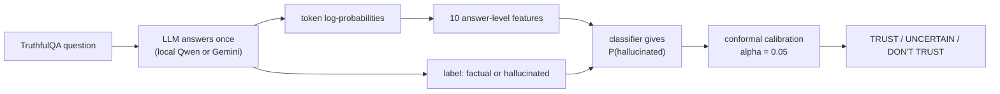

# Hallucination Lens


**Estimate how risky a large language model (LLM) answer is, using only the token log-probabilities the model already produces, and wrap the result in conformal prediction so every verdict carries a statistical error guarantee.**

Built for the Statistical Machine Learning course (CSET211) at Bennett University. This is version 2 of the course project: it runs locally on Apple-silicon Macs, adds a Gemini application programming interface (API) backend, and implements the "future work" list from the original report.

## What it does



No second model and no extra generation pass are needed at answer time: one forward pass, a few arithmetic operations, and a verdict.

| Conformal label set | Verdict | Meaning |
|---|---|---|
| {factual} | **TRUST** | the "hallucinated" label was ruled out at the chosen confidence |
| {factual, hallucinated} | **UNCERTAIN** | the evidence cannot decide, so double-check |
| {hallucinated} | **DON'T TRUST** | the "factual" label was ruled out |
| {} (empty) | **UNUSUAL** | neither label fits; treat as unreliable |

New to the ideas? Read [docs/HOW_IT_WORKS.md](docs/HOW_IT_WORKS.md): every concept is explained from the basics with a worked numeric example.

## Results

**Baseline: the original course report** (150 questions, Qwen2.5-1.5B-Instruct, 23 test answers):

| Measure | Value |
|---|---|
| Classifier accuracy | 69.57% (always guessing "hallucinated" scores 68%) |
| Target coverage | 95% |
| Measured conformal coverage | 95.65% (22 of 23) |
| Average prediction-set size | 1.70 (about 70% of answers were "uncertain") |

The report itself notes that 23 test answers and 22 calibration answers are too few to draw strong conclusions. That is the main thing version 2 fixes.

**Version 2:** run the pipeline and each run writes a `REPORT.md` with every metric and figure. Compare runs with `hallucination-lens compare`. Fill in this table from your own runs:

| Run | Answers | AUROC | Coverage | Avg set size | TRUST rate | Hallucinations wrongly TRUST |
|---|---|---|---|---|---|---|
| `report_replication` | 150 | _fill in_ | _fill in_ | _fill in_ | _fill in_ | _fill in_ |
| `local_qwen2.5-3b-instruct` | 817 | _fill in_ | _fill in_ | _fill in_ | _fill in_ | _fill in_ |

(AUROC = area under the receiver operating characteristic curve, where 0.5 means no signal and 1.0 means perfect.)

## Quick start on a Mac (Apple silicon)

You need macOS, Python 3.10 to 3.13 (3.12 is a good choice), git, and roughly 10 GB of free disk space for the default model.

```bash
# 1. get the code
git clone https://github.com/YOUR-USERNAME/hallucination-lens.git
cd hallucination-lens

# 2. create an isolated Python environment
python3 -m venv .venv
source .venv/bin/activate

# 3. install everything (PyTorch, Transformers, Gemini client, ...; takes a few minutes)
pip install --upgrade pip
pip install -e ".[all]"

# 4. check the install: no model download, no API key, about 10 seconds
hallucination-lens smoke-test

# 5. measure your Mac's speed: let the 3B model answer 10 questions, then label them
hallucination-lens generate --set data.n_questions=10 --set run.name=quick_trial
hallucination-lens label    --set data.n_questions=10 --set run.name=quick_trial

# 6. the real run: all 817 questions (resumable; you can stop and restart any time)
hallucination-lens run-all --config configs/default.yaml
```

Open `runs/local_qwen2.5-3b-instruct/REPORT.md` for the results, then try the guardrail on your own question:

```bash
hallucination-lens ask --run runs/local_qwen2.5-3b-instruct "What happens if you swallow gum?"
```

The command prints the answer, P(hallucinated), the conformal label set and the verdict.

> The training stage needs at least about 100 answers to be meaningful (it refuses to run with fewer than 5 of each class). The 10-question trial in step 5 only tests generation and labelling.

### Using Visual Studio Code (VS Code)

1. Open the folder: `File > Open Folder > hallucination-lens`, and accept the recommended extensions.
2. Select the interpreter: `Cmd+Shift+P > Python: Select Interpreter > .venv`.
3. Press `F5` and pick a ready-made configuration from the Run and Debug panel (smoke test, full pipeline, Gemini check, ask the guardrail).
4. Open `notebooks/walkthrough.py`: it uses `# %%` cells, so each block has a "Run Cell" button and shows results in an interactive window, like a Jupyter notebook but with clean Git diffs.
5. The Testing panel runs the unit tests.

## Project layout

```
hallucination-lens/
├── README.md                  <- you are here
├── pyproject.toml             <- package definition and dependencies
├── requirements.txt           <- one-line install: pip install -r requirements.txt
├── Makefile                   <- shortcuts: make setup / smoke / test / run-local
├── .env.example               <- copy to .env and add GEMINI_API_KEY (never commit .env)
├── configs/                   <- experiment settings in YAML files (one per experiment)
│   ├── default.yaml           <- local Qwen2.5-3B, all 817 questions (every option documented)
│   ├── reproduce_report.yaml  <- the original 150-question setup, for comparison
│   ├── local_qwen7b.yaml      <- a stronger local model (about 15 GB of memory)
│   └── gemini_flash.yaml      <- Gemini as the answering model + Gemini judge for labels
├── src/hallucination_lens/    <- the code, one file per idea
│   ├── config.py              <- loads and validates the YAML settings
│   ├── data.py                <- downloads TruthfulQA
│   ├── backends/              <- "who answers?"
│   │   ├── local_hf.py        <-   open-weight model on the Apple GPU
│   │   └── gemini.py          <-   Gemini API
│   ├── features.py            <- log-probabilities -> 10 numbers per answer
│   ├── labeling.py            <- factual vs hallucinated (embeddings or Gemini judge)
│   ├── modeling.py            <- classifiers and the train/calibration/test split
│   ├── conformal.py           <- conformal prediction written from scratch
│   ├── evaluation.py          <- metrics, repeated-split test, alpha sweep
│   ├── plots.py               <- every figure
│   ├── guardrail.py           <- answer + verdict for a new question
│   ├── pipeline.py            <- the three stages
│   └── cli.py                 <- the `hallucination-lens` command
├── tests/                     <- 37 unit tests (run without a model or API key)
├── notebooks/walkthrough.py   <- guided tour in VS Code "# %%" cells
├── docs/                      <- HOW_IT_WORKS.md and GEMINI.md
├── legacy/                    <- the original Colab notebook, outputs stripped
├── data/                      <- cached answers and tables (git-ignored)
└── runs/                      <- results of each experiment: metrics, figures, REPORT.md
```

## The three stages

Each stage saves its output, so you can re-run a later stage without repeating the slow one.

| Stage | Command | Reads | Writes |
|---|---|---|---|
| 1. Generate | `hallucination-lens generate` | TruthfulQA questions | `data/generations/<run>.jsonl` (resumable) |
| 2. Label | `hallucination-lens label` | the answers above | `data/processed/<run>.csv` (features + labels) |
| 3. Train and evaluate | `hallucination-lens train` | the table above | `runs/<run>/` (model, `metrics.json`, `REPORT.md`, figures, predictions) |
| all three | `hallucination-lens run-all` | | |

Change anything without editing code, for example `--set generation.model_id=Qwen/Qwen2.5-7B-Instruct`, `--set conformal.alpha=0.1`, or `--set label.method=gemini_judge`.

## Choosing the answering model

**Local model on your Mac (recommended).** The code uses the Apple graphics processing unit (GPU) through PyTorch's Metal Performance Shaders (MPS) backend. Memory needed for the weights is roughly parameters times 2 bytes in bfloat16:

| Model | Weights in memory | Fit on 24 GB of random-access memory (RAM)? |
|---|---|---|
| Qwen2.5-1.5B-Instruct (original report) | about 3 GB | easily |
| **Qwen2.5-3B-Instruct (default)** | about 6 GB | comfortably |
| Qwen2.5-7B-Instruct | about 15 GB | yes, but close other heavy apps first |

Local models expose the full probability distribution, so nothing is hidden from the method. Speed depends on your machine: run the 10-question trial and multiply by about 82 to estimate all 817.

**Gemini.** Read [docs/GEMINI.md](docs/GEMINI.md) before using it. In short: as reported on Google's developer forum, Gemini 3.x models no longer return token log-probabilities, which this method needs, so the answering model is `gemini-2.5-flash`, and `hallucination-lens gemini-check` tells you whether your key works for it. Newer Gemini models are still useful as the **judge** that produces better labels (`--set label.method=gemini_judge`), because judging needs no log-probabilities.

## Upgrades over the original report

| Area | Original report | This version |
|---|---|---|
| Data | first 150 questions; 22 calibration and 23 test answers | all 817; about 123 calibration and 123 test answers |
| Prompting | raw question, no chat template | chat template plus a short system prompt |
| Decoding | model's default sampling (results change between runs) | greedy decoding: same question, same answer |
| Features | 4 | 10 (adds entropy, margin, first-token, low-confidence share, 10th percentile, finished flag) |
| Labels | similarity to `best_answer` only | similarity to **all** correct references; optional Gemini judge with agreement statistics |
| Classifier | unscaled logistic regression | scaled logistic regression; random forest and boosting available; cross-validated selection |
| Conformal | MAPIE library, marginal guarantee only | written from scratch and cross-checked against MAPIE in a test; adds a **class-conditional** variant |
| Guardrail rule | every one-label set called "verified" (a `{hallucinated}` set would wrongly pass) | TRUST / UNCERTAIN / DON'T TRUST / UNUSUAL, decided by which label is in the set |
| Evaluation | accuracy and coverage on 23 answers | adds AUROC, Brier score, expected calibration error (ECE), majority baseline, raw-confidence baseline, 200 random re-splits, alpha sweep, "hallucinations wrongly stamped TRUST" |
| Engineering | one notebook | installable package, command-line interface (CLI), YAML configs, resumable caching, 37 tests, continuous integration (CI) |

MAPIE stands for Model Agnostic Prediction Interval Estimator, a conformal prediction library.

## Limitations (please read)

- **Labels are a proxy for truth.** Embedding similarity measures closeness in meaning, and an LLM judge can be wrong too. Check the agreement numbers in `data/processed/<run>.label_audit.json`.
- **The guarantee has assumptions.** Conformal coverage holds when new answers resemble the calibration answers (exchangeability). A new model, prompt style or subject area needs a fresh calibration run.
- **It measures confidence, not truth.** A confidently wrong answer can still earn TRUST.
- **Weak signal is possible.** If the features barely predict hallucination, the guarantee still holds but most verdicts become UNCERTAIN. The report compares accuracy with the majority baseline for exactly this reason.
- Research prototype; not for production or safety-critical use.

## Development

```bash
pytest                    # 37 tests, about 6 seconds, no model or API key needed
ruff check src tests      # lint
```

Heavy libraries (PyTorch, Transformers) are imported only when a model actually runs, so tests and the CI workflow in `.github/workflows/ci.yml` stay light.

## References

Lin, Hilton and Evans (2022), *TruthfulQA*. Angelopoulos and Bates (2021), *A gentle introduction to conformal prediction*. Sadinle, Lei and Wasserman (2019), *Least ambiguous set-valued classifiers with bounded error levels* (the "LAC" score: least ambiguous set-valued classifier). Vovk, Gammerman and Shafer (2005), *Algorithmic Learning in a Random World*. Guo et al. (2017), *On calibration of modern neural networks*. Kadavath et al. (2022), *Language models (mostly) know what they know*. Quach et al. (2023), *Conformal language modeling*. Full list in the original report.

## License

MIT. See [LICENSE](LICENSE).
