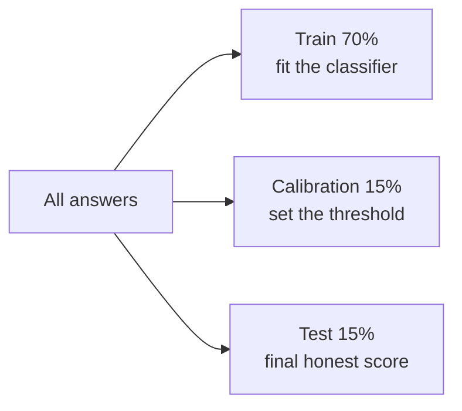

# How it works (no prior knowledge needed)

This page explains every idea in the project from the basics. Abbreviations are spelled out where they first appear.

## 1. The problem

A large language model (LLM) writes with the same smooth, confident tone whether it is right or wrong. We would like a *warning light*: "careful, this answer might be a hallucination" (a fluent statement that is false).

Asking a second, bigger model to fact-check every answer works but doubles the cost. Reading the model's internal numbers needs special access. This project asks a cheaper question: **can the probabilities the model already produced while writing the answer tell us how risky it is?**

## 2. Token log-probabilities: what the model already gives us

An LLM writes one *token* (a word or piece of a word) at a time. At every step it assigns a probability to each possible next token and picks one. We store the **logarithm** of the probability of the token it picked (the *log-probability*, or logprob). It is always 0 or negative:

| Token probability | Log-probability | Meaning |
|---|---|---|
| 0.99 | -0.01 | very sure |
| 0.50 | -0.69 | a coin flip |
| 0.05 | -3.00 | the model was surprised by its own choice |

So one answer becomes a list such as `[-0.01, -0.30, -2.10, -0.05, ...]`.

## 3. Features: turning that list into a few numbers

A classifier needs the same number of inputs for every answer, so we summarise each list:

| Feature | Plain meaning |
|---|---|
| `mean_logprob` | average confidence |
| `var_logprob` | how bumpy the confidence is |
| `min_logprob` | the single least-confident token (weakest link) |
| `output_length` | number of tokens |
| `first_token_logprob` | confidence in how the answer starts |
| `q10_logprob` | 10th-percentile logprob, a sturdier version of the minimum |
| `frac_low_conf` | share of tokens with probability below 50% |
| `mean_entropy_topk` | average uncertainty among the top 5 candidate tokens (*entropy* = how spread out the probabilities are) |
| `mean_margin_topk` | average gap between the best and second-best candidate |
| `finished_naturally` | 1 if the model stopped by itself, 0 if it was cut off |

The first four are the original report's features. The other six are new.

## 4. Labels: how do we know which answers were hallucinations?

TruthfulQA (a benchmark of 817 questions designed to trigger common misconceptions) provides, for each question, lists of correct and incorrect reference answers. Two ways to label:

- **Embedding similarity** (default, free): convert the answer and all references into vectors that capture meaning. If the answer is closer to a correct reference than to any incorrect one, label it factual (0), otherwise hallucinated (1). This measures *similarity in meaning*, not truth, so it is a proxy and sometimes wrong.
- **Gemini as judge** (optional): a strong LLM reads the question, the references and the answer and returns a verdict. When it says "unsure", we fall back to the embedding label. The pipeline reports how often the two methods agree (Cohen's kappa, a score where 0 = chance agreement and 1 = perfect agreement), which tells you how much to trust the labels.

## 5. The classifier

A logistic regression (a model that outputs a probability between 0 and 1 from a weighted sum of the features) is trained to output **P(hallucinated)**. We standardise the features first (put them on comparable scales), which the original notebook skipped. Random forest and gradient boosting are available as alternatives.

On its own, P(hallucinated) is not trustworthy: classifiers are often over- or under-confident (this is what *calibration* means), and ours has weak signal. So we add conformal prediction.

## 6. Conformal prediction: a guarantee around any classifier

The data is split into three separate groups. Each has exactly one job:



**Worked example** (small numbers so you can follow along; it is also a unit test in `tests/test_conformal.py`).

1. Ten calibration answers. For each, compute the **surprise** `1 - P(true label)`. Suppose they sorted are
   `0.05, 0.10, 0.12, 0.20, 0.25, 0.31, 0.40, 0.48, 0.55, 0.90`.
2. We accept being wrong 20% of the time, so alpha = 0.2. Take the `ceil((10 + 1) * 0.8) = 9`th smallest score: **q = 0.55**. (The "+1" is a small safety correction that makes the guarantee exact for finite data.)
3. A new answer gets every label whose surprise is at most q:

```
surprise number line:   0 ---------------- 0.55 ------------------ 1
                                            q
                          labels inside here are KEPT  |  labels out here are dropped
```

| New answer: P(factual), P(hallucinated) | Surprise of factual | Surprise of hallucinated | Label set | Verdict |
|---|---|---|---|---|
| 0.90, 0.10 | 0.10 (kept) | 0.90 (dropped) | {factual} | TRUST |
| 0.45, 0.55 | 0.55 (kept) | 0.45 (kept) | {factual, hallucinated} | UNCERTAIN |
| 0.30, 0.70 | 0.70 (dropped) | 0.30 (kept) | {hallucinated} | DON'T TRUST |

**The guarantee:** if calibration and new answers come from the same kind of data, the true label lands inside the set with probability at least 1 - alpha. It holds for *any* classifier. A weak classifier does not break the guarantee; it just produces more UNCERTAIN verdicts.

**Class-conditional variant (default here).** The plain guarantee is an average over all answers and can hide a bad rate on one class. We repeat the procedure separately for factual and hallucinated answers. Then, among answers that really are hallucinations, at most about alpha are wrongly stamped TRUST. That is the safety property a guardrail needs, and the pipeline reports it as `false_reassurance_rate`.

## 7. How to judge the results honestly

- **Accuracy vs. majority baseline.** If 68% of answers are hallucinated, a classifier that always says "hallucinated" scores 68%. Beat that before celebrating.
- **AUROC** (area under the receiver operating characteristic curve): the chance that a random hallucinated answer gets a higher score than a random factual one. 0.5 = no signal, 1.0 = perfect.
- **Expected calibration error (ECE)**: how far the predicted probabilities are from the observed rates. 0 is ideal.
- **Coverage and set size.** Coverage should be near the target (95%). Smaller sets are better; the trade-off is shown in `alpha_sweep.png`.
- **Repeated splits.** One test split of ~120 answers is noisy: one answer moves coverage by about 1 point. The pipeline re-splits 200 times and shows the average, which is a far better check of the guarantee.

## 8. What this does *not* do

- It scores the model's **confidence profile**, not the truth. A confidently wrong answer can still get TRUST.
- Labels are proxies; results are only as good as the labels.
- The guarantee assumes new questions look like the calibration questions. A different domain, model, or prompt style needs a fresh calibration run.
- Not production-ready; it is a coursework-grade research prototype.
