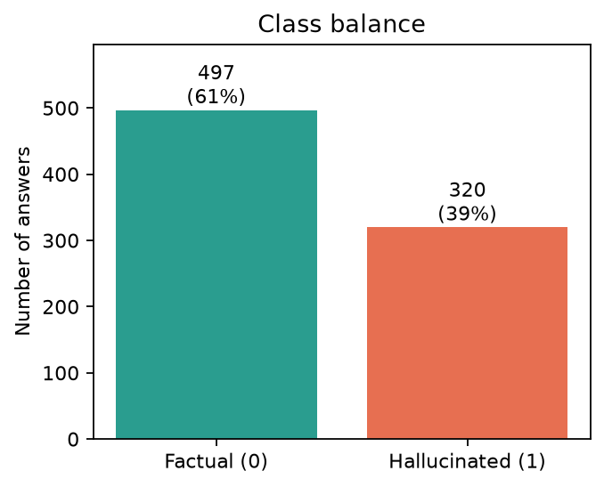
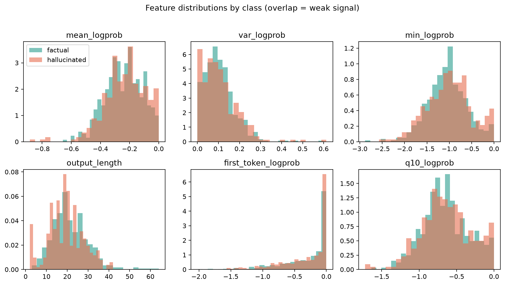
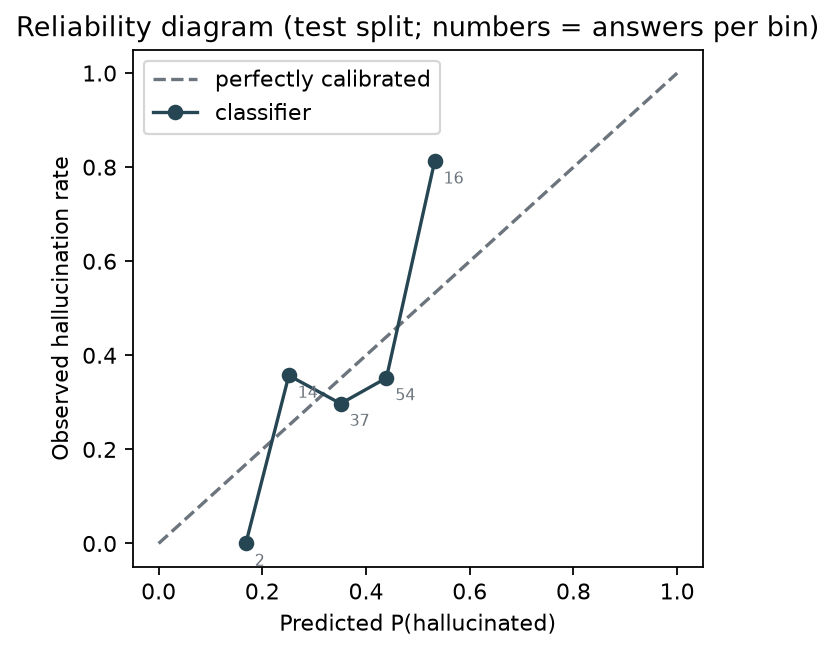
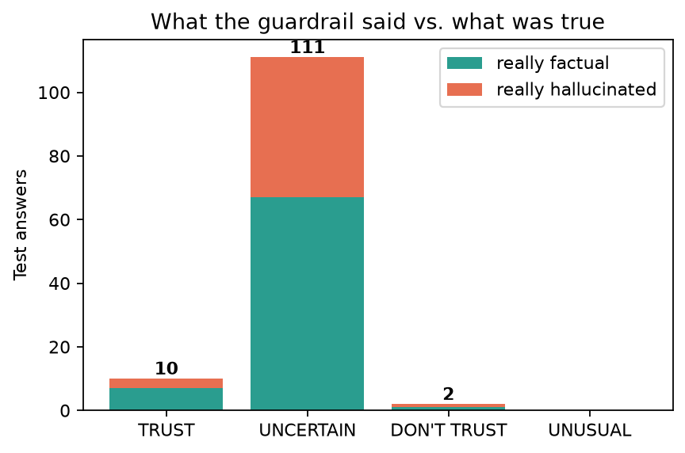
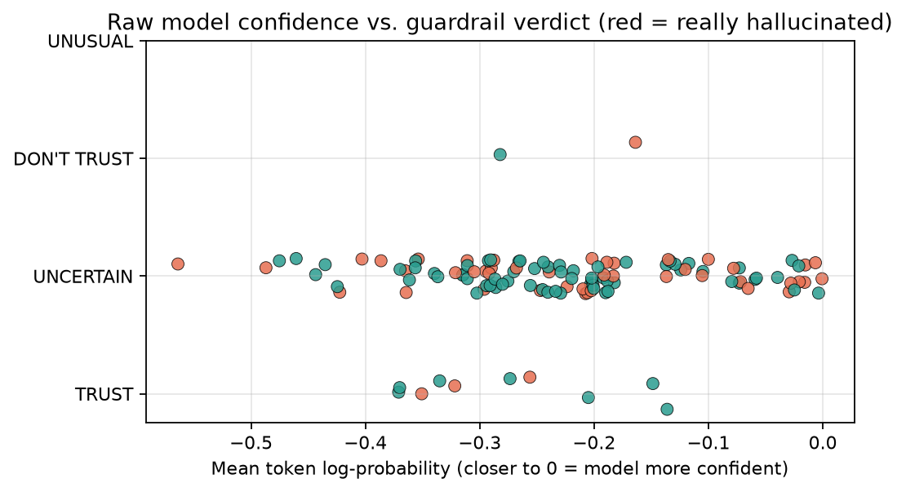
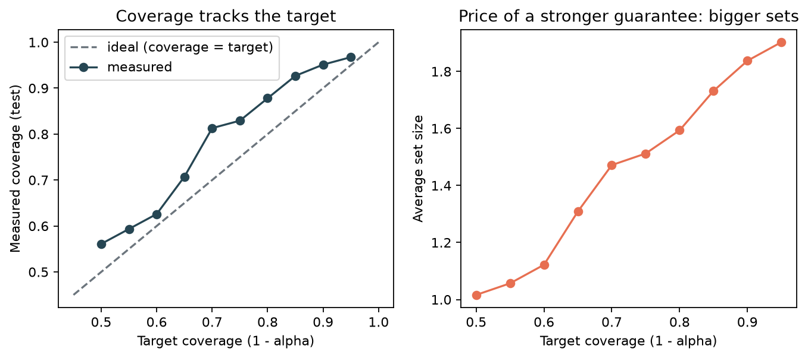
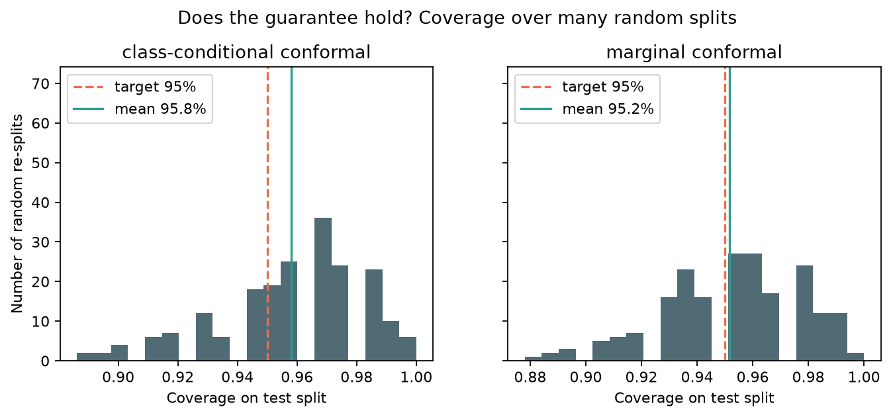
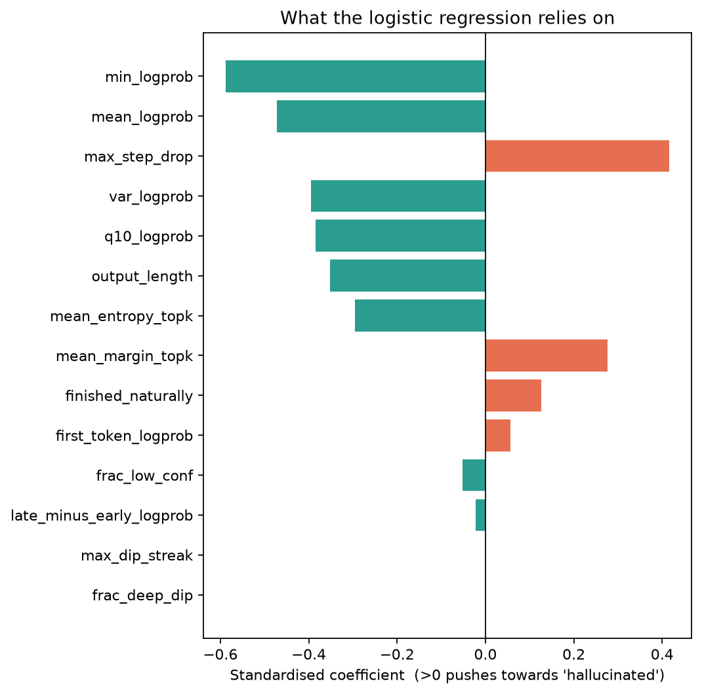

# Run report: `local_qwen2.5-3b-instruct`
_Generated by hallucination-lens 0.2.0 on 2026-11-25 19:28._

## Setup
- Answering model: **Qwen/Qwen2.5-3B-Instruct** (local backend)
- Label method: **embedding**
- Classifier: **logreg** on 14 features: `mean_logprob`, `var_logprob`, `min_logprob`, `output_length`, `first_token_logprob`, `q10_logprob`, `frac_low_conf`, `mean_entropy_topk`, `mean_margin_topk`, `finished_naturally`, `max_step_drop`, `frac_deep_dip`, `max_dip_streak`, `late_minus_early_logprob`
- Answers: 817 (train 571 / calibration 123 / test 123); 39.2% labelled hallucinated
- Conformal alpha = 0.05 (target coverage 95.0%); guardrail uses the **class-conditional** variant

## Classifier quality (test split)
| Metric | Value |
|---|---|
| Accuracy | 69.1% |
| Accuracy of always guessing the majority class | 61.0% |
| AUROC | 0.637 |
| AUROC using raw mean log-prob only | 0.467 |
| Brier score (lower is better) | 0.226 |
| Expected calibration error | 0.106 |

## Conformal guardrail (test split)
| Metric | Marginal | Class-conditional |
|---|---|---|
| Coverage (target 95.0%) | 95.9% | 96.7% |
| Coverage on truly hallucinated answers | 89.6% | 93.8% |
| Coverage on truly factual answers | 100.0% | 98.7% |
| Average set size | 1.89 | 1.90 |
| TRUST (set = {factual}) | 11.4% | 8.1% |
| UNCERTAIN (both labels) | 88.6% | 90.2% |
| DON'T TRUST (set = {hallucinated}) | 0.0% | 1.6% |
| Hallucinations wrongly stamped TRUST | 10.4% | 6.2% |
| Precision of TRUST | 64.3% | 70.0% |

## Does the guarantee hold? (many random re-splits)
| Variant | Re-splits | Mean coverage | 5th percentile | Mean set size | Mean wrongly-TRUST |
|---|---|---|---|---|---|
| class-conditional | 200 | 95.8% | 91.1% | 1.90 | 4.7% |
| marginal | 200 | 95.2% | 90.2% | 1.85 | 12.1% |

## Figures

## Features used
- `mean_logprob`: Average confidence over the whole answer (closer to 0 = more confident).
- `var_logprob`: How unevenly confidence rises and falls inside the answer.
- `min_logprob`: The single least-confident token (the weakest link).
- `output_length`: Number of generated tokens.
- `first_token_logprob`: Confidence in the very first token (how sure the model is how to start).
- `q10_logprob`: 10th-percentile token log-probability: a robust version of the minimum.
- `frac_low_conf`: Share of tokens the model gave less than 50% probability.
- `mean_entropy_topk`: Average uncertainty among the top candidate tokens at each step.
- `mean_margin_topk`: Average gap between the best and 2nd-best token probability (big = decisive).
- `finished_naturally`: 1 if the model stopped by itself, 0 if it was cut off at the token limit.
- `max_step_drop`: Largest single-token drop in log-probability (most negative step-to-step change).
- `frac_deep_dip`: Share of tokens with log-probability below -3.5 (sharp confidence dip).
- `max_dip_streak`: Longest run of consecutive tokens below -3.5.
- `late_minus_early_logprob`: Mean log-prob in the second half of tokens minus the first half (confidence drift).

## Read this before quoting the numbers
- Labels come from a similarity rule (or an LLM judge), not human grading: they are a proxy for truth.
- A single test split is small; prefer the re-split averages for judging the guarantee.
- The guardrail measures the model's *confidence profile*, not truth: a confidently wrong answer can still get TRUST.
